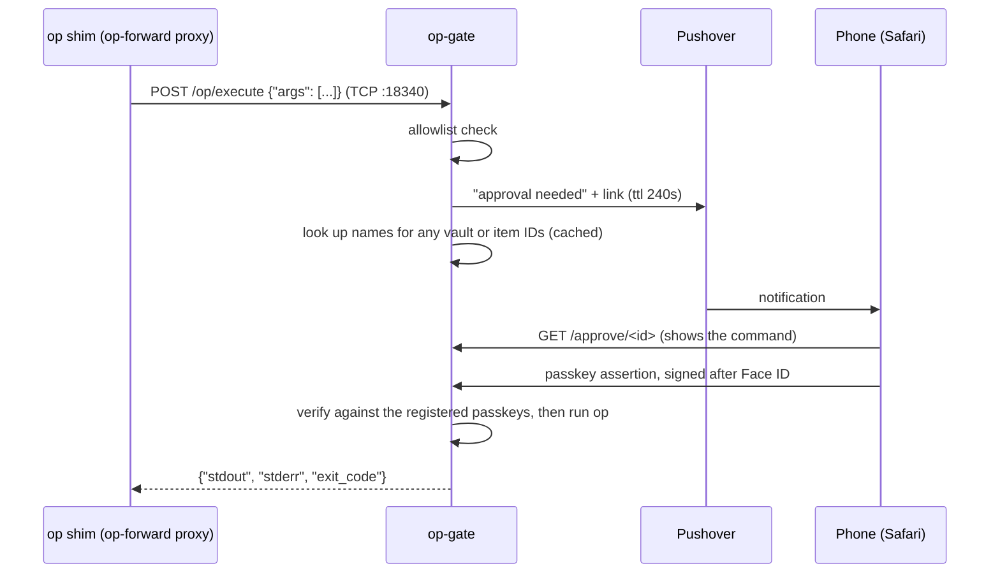
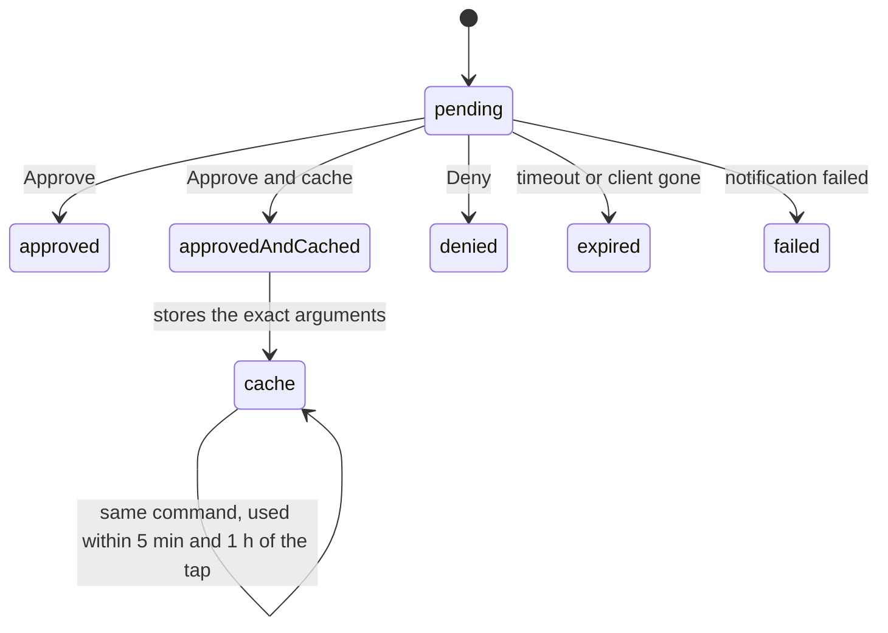

# op-gate

> [!WARNING]
> **This is a vibecoded personal project.** I built it with an AI coding agent for my own setup. Nobody has audited it, and I don't promise to maintain it.
>
> The threat model is loose. op-gate assumes its ports sit on a private network, and that nothing on the calling machine can read its service account token or edit its passkeys directory. It guards against an agent quietly reading secrets, not against a determined attacker. Read the [security model](#security-model) before you run it, and don't point it at secrets you can't afford to leak.

op-gate runs 1Password CLI (`op`) commands for remote agents, and each one needs an approval with a passkey on your phone first. It fills the gap left by [op-forward](https://github.com/ekovshilovsky/op-forward), which forwards `op` to a Mac and waits on Touch ID. That works only while someone is at the Mac.

op-gate speaks op-forward's wire protocol, so the stock op-forward `op` shim reaches it by pointing `OP_FORWARD_ADDR` at it:

```sh
OP_FORWARD_ADDR=tcp://op-gate.example.com:18340 op read "op://Agents/GitHub Token/credential"
```

Your phone gets a Pushover notification: "An op command is waiting for your approval." Its link opens the approval page in Safari, which shows the client that asked and `op read "op://Agents/GitHub Token/credential"`. **Approve** asks for Face ID. Then the command's output comes back to the caller as if `op` had run locally.

## How it works



op-gate listens on two ports, one job each:

| Port | Serves | Expose it through |
|---|---|---|
| 18340 | `POST /op/execute` (op-forward's protocol) and `/health` | Plain TCP. The op-forward client speaks plain HTTP, so it can't go through an HTTPS proxy. |
| 8080 | The approval and registration pages | A TLS-terminating reverse proxy, because passkeys need HTTPS |

Neither port authenticates callers. Every command still needs a passkey approval, but keep both ports on a private network: a LAN, a VPN, or a tailnet.

### Why the notification is generic

The Pushover message never includes the command, because Pushover's servers would see item names. The approval page shows it instead. The message uses priority 0, so Quiet Hours silence it, and a request at night just times out. Its `ttl` deletes it from the phone when the 4-minute approval window ends.

## Approving and denying

- **Approve** requires a registered passkey with user verification (Face ID, Touch ID, or the device passcode). A passkey assertion without user verification is rejected.
- **Deny** needs no passkey, since denying can't release anything.
- Each request has a random ID and one challenge at a time. A challenge can be answered once, right or wrong.
- A request is decided once. After it's approved, denied, or expired, its page only shows that outcome. The page never shows `op`'s output.

## Names on the approval page

Agents often refer to vaults and items by ID, such as `op read "op://a1b2.../c3d4.../credential"`. The approval page lists a name for each ID under the command, so you know what you're approving:

```
vault a1b2c3d4 = Agents
item  c3d4e5f6 = GitHub Token
```

The command above the list is still exactly what `op` runs. A line can also say:

- `item c3d4e5f6 not found`: no vault op-gate's service account can read has that ID. The command will fail.
- `item c3d4e5f6 not found in Private`: the item exists, but not in the vault the command names. The command will fail.
- `Couldn't look up names.`: the lookup itself failed, and the last good list doesn't have every ID. It says nothing about the command.

op-gate finds IDs in `op://` references, in `--vault`, and in the arguments of `item get`, `document get`, and `vault get`. Any value of 26 lowercase letters and digits counts as an ID, so a name of that shape reads as `not found`, even though `op` finds it. Other names are left alone, since the command already shows them.

The names come from `op vault list` and `op item list`, which return titles but no field values. op-gate never runs `op item get` for a lookup, because that returns field values, and op-gate would read secrets you haven't approved.

op-gate caches every vault and item name it can read, because service accounts have rate limits:

- It starts a lookup as soon as a request arrives, so the names are usually ready when you open the page. The page waits up to 5 seconds for them.
- The cache lives 10 minutes, so a renamed item can show its old name until then.
- An ID that's missing from the cache refreshes it early, at most once every 30 seconds. A failed lookup also waits 30 seconds before the next try, and the page keeps using the last good list meanwhile.
- Commands without IDs, and cached approvals, look nothing up.

Names appear only on the approval page, and only while the request is pending. They never reach Pushover, logs, or spans.

## Cached approvals

Agents often run the same command several times in a few minutes. **Approve and cache for 1 hour** approves the request with the same passkey check as **Approve**, and also lets that exact command from the same client run again without asking you.

A cached approval:

- matches only the same client (see [Client tokens](#client-tokens)) and the exact argument list. `op read "op://Agents/X/credential"` doesn't cover `op read "op://Agents/X/credential" --no-newline`.
- lapses after 5 minutes without use, and never lasts more than an hour after your tap, however often it's used.
- stores the approval, not the output. `op` runs again for each request, so a rotated secret comes back new.
- sends no notification and opens no page when it's used.
- lives in memory. Restarting op-gate clears every cached approval, and there's no other way to revoke one early.

Plain **Approve** caches nothing, and denials are never cached.



## Registering a passkey

op-gate reads passkeys from a directory, one file per passkey, and never writes to it:

1. Open `https://<approval host>/register` on the device and tap **Create passkey**.
2. The page shows one line of JSON: the passkey's public key and ID. It holds nothing secret.
3. Save that line as a new file in the passkeys directory, named for the device (lowercase letters, digits, `-` or `.`, no spaces).
4. Restart op-gate. It loads passkeys at startup.

On Kubernetes, the passkeys directory is usually a mounted Secret with one key per device. If a secrets operator syncs that Secret from a password manager, adding a field registers a device. For example, the 1Password operator can restart the pod for you when its item changes.

Anyone who can reach the page can register, and that's harmless: a passkey does nothing until its line is in the passkeys directory. To remove a device, delete its file.

Synced passkeys, like those in iCloud Keychain, cover every device on that account with one registration. Registering again from the same account fails, because registration excludes passkeys that are already registered.

## What it allows

The first argument must be one of these subcommands. Flags before the subcommand are rejected.

| Command | Allowed |
|---|---|
| `read` | yes |
| `whoami` | yes |
| `item get`, `item list` | yes |
| `vault get`, `vault list` | yes |
| `document get` | yes |
| anything else (`run`, `inject`, `signin`, writes, ...) | no |

`run` and `inject` matter most. `op run -- env` would print op-gate's environment, service account token included. op-gate also runs `op` with only `PATH`, `HOME`, and `OP_SERVICE_ACCOUNT_TOKEN` in its environment.

Give op-gate a read-only service account, so writes fail at 1Password regardless. The allowlist keeps them from reaching your phone at all.

## Responses

Every response is HTTP 200 with op-forward's JSON body, because the client treats any other status as "proxy unavailable."

| Situation | Exit code | stderr |
|---|---|---|
| Approved | `op`'s own | `op`'s own |
| No valid client token | 1 | `op-gate: this client has no token`, followed by setup steps |
| Not allowed | 1 | `op-gate: "<cmd>" is not allowed` |
| Denied | 1 | `op-gate: denied` |
| No approval within 4 minutes | 1 | `op-gate: no approval within 4m0s` |
| Notification failed | 1 | `op-gate: sending notification: pushover: ...`, with Pushover's error |
| `op` exits 127 | 1 | `op-gate: op exited 127`, then `op`'s stderr |

op-gate never returns 127. The op-forward shim reads 127 as "proxy unavailable" and silently runs the local `op` instead.

### Timing

op-gate waits up to 4 minutes for an approval, then gives `op` 30 seconds. Clients must set `OP_FORWARD_FETCH_TIMEOUT_MS=300000`. The client's default of 60 seconds gives up before most approvals arrive.

If the client disconnects, the request expires, and its page says so.

## Configuration

| Variable | Required | Meaning |
|---|---|---|
| `OP_SERVICE_ACCOUNT_TOKEN` | yes | 1Password service account token. Make it read-only. |
| `APPROVAL_URL` | yes | Origin of the approval page, such as `https://op-gate.example.com`. Passkeys are bound to its host, so changing it invalidates them. |
| `PASSKEYS_DIR` | yes | Directory with one registered passkey per file. Empty files are skipped. An invalid file stops op-gate at startup, naming the file. |
| `PUSHOVER_TOKEN_REF` | yes | `op://` reference to the Pushover application token. op-gate reads it at startup with the service account. |
| `PUSHOVER_USER_REF` | yes | `op://` reference to the approver's Pushover user key |
| `LISTEN_ADDR` | no | op-forward listener. Defaults to `:18340`. |
| `APPROVAL_LISTEN_ADDR` | no | Approval page listener. Defaults to `:8080`. |
| `OTEL_EXPORTER_OTLP_ENDPOINT` | no | Enables trace export over OTLP/HTTP, along with the other standard `OTEL_*` variables. |

### Client tokens

op-gate identifies each client by its token. The op-forward client sends the first line of `access.token` in its token directory as a bearer token. op-gate expects it in the form `<name>:<secret>`:

- `name` is 1 to 32 characters of `a-z`, `0-9`, `.`, and `-`. Use the machine's short hostname. The approval page shows it, but nothing verifies it.
- `secret` is at least 32 characters. Generate it randomly.

op-gate identifies the client by the SHA-256 of the whole token. The approval page, logs, and spans show its first 8 hex characters next to the name, so two clients claiming the same name still look different. A request without a valid token is rejected with setup steps on stderr.

```sh
dir=~/.cache/op-gate
mkdir -p "$dir" && chmod 700 "$dir"
name=$(hostname -s | tr 'A-Z' 'a-z' | tr -c 'a-z0-9.\n-' '-' | cut -c1-32)
printf '%s:%s\n2099-01-01T00:00:00Z\n' "$name" "$(openssl rand -hex 32)" > "$dir/access.token"
cp "$dir/access.token" "$dir/refresh.token"
chmod 600 "$dir"/*.token
export OP_FORWARD_TOKEN_DIR="$dir"
```

The client refuses to send a request without both files. The far-future expiry keeps it from calling `/token/refresh`, which op-gate doesn't implement.

Everything that shares a token directory is one client, so every agent on a machine shares its cached approvals. Keep a machine's token once it's set: a new token is a new client, with none of the old one's cached approvals.

### Agent skill

[`skill/SKILL.md`](skill/SKILL.md) teaches a Claude Code agent to use op-gate: the allowed commands, what **Approve and cache** means, what to do after a denial, and how to set up a client token. Install it on each machine by copying it to `~/.claude/skills/op-gate/SKILL.md`.

## Operations

- **Run one replica.** Pending requests live in memory, so a second instance would hold requests the first doesn't know about. A restart fails any request that's waiting.
- **Logs** are JSON on stdout: one line per request with its ID, client (`client_id`, the short ID, and `client_name`), subcommand, outcome, exit code, and duration. A request without a valid token has outcome `no_client` and no client fields. A request answered from a cached approval has outcome `cache_hit`, and a `cached approval used` line before it names the request that created the approval in `approved_by`. A failed name lookup logs `looking up names` once, with op's error. They never include arguments, output, or looked-up names, since those carry item names. Every line has `"service":"op-gate"`, and lines logged inside a span carry its `trace_id` and `span_id`, so a log pipeline can link them to traces.
- **Traces:** spans for each request, the Pushover call, the passkey check, each name lookup, and each `op` run, with the request ID, client, and outcome as attributes. A cache hit's request span also carries `op_gate.approved_by`. A name lookup's span (`op_gate.names`) records how many IDs it looked up, how many it didn't find, and whether it refreshed the cache, without naming anything.
- **`op` upgrades:** the base image is pinned by digest. Renovate opens upgrade PRs, which aren't automerged, because a renamed subcommand would change what the allowlist allows.

## Security model

op-gate protects against an agent reading secrets through ordinary `op` calls that you didn't approve. Approving needs a passkey and user verification on your device, so nothing on the calling machine can fake it.

It does not protect against an agent with other ways to reach the secrets. One example is cluster credentials that can read op-gate's service account token or change its passkeys directory. The approval is only as strong as the weakest credential the calling machine already holds.

A cached approval works only for the client whose request you approved. Anything that can read that client's token file can act as the client, including other processes running as the same user on that machine. The token travels as a bearer token over plain HTTP, so keep port 18340 on a private network. A client's name is whatever its token claims; compare the 8-character ID on the approval page when it matters. Restart op-gate to clear every cached approval.

## Development

```sh
go test -race ./...
```

`TestPageScripts` drives the pages in headless Chromium with a virtual authenticator, and is skipped when Chromium isn't installed. `TestPasskeysEndToEnd` runs the real WebAuthn checks with a virtual authenticator from [`descope/virtualwebauthn`](https://github.com/descope/virtualwebauthn).

## License

MIT. See [LICENSE](LICENSE).
